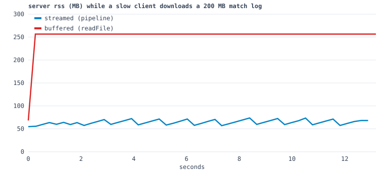

# Space Arena — Lab 04

Node-сервер для гри з Lab 01–03: **кімнати, вхід, вихід і чат через WebSocket**, HTTP API, логи матчів як потоки. Координати кораблів між клієнтами поки не передаються, це буде Lab 05. Кожен клієнт грає свою локальну партію, а кімната і чат спільні.

## Структура (npm workspaces)

```text
space-arena/
├── package.json            # "workspaces": ["client", "server"]
├── scripts/dev.mjs         # npm run dev — сервер + Vite разом
├── docs/rss.svg, rss.csv   # графік пам'яті (backpressure)
├── client/                 # Vite-застосунок з Lab 01–03
│   ├── vite.config.js      # proxy /api, /health, /ws → Node
│   └── src/
│       ├── net/connection.js   # обгортка WebSocket: черга send + reconnect з backoff
│       ├── ui/chat.js          # чат і список гравців
│       └── lobby/…             # лобі через справжній GET/POST /api/rooms
└── server/
    ├── package.json        # "type": "module", dependencies: ws
    ├── .env.example        # конфіг з оточення
    ├── src/
    │   ├── index.js        # старт, SIGINT/SIGTERM → graceful shutdown
    │   ├── app.js          # збирає http + ws + кімнати + логи (createApp для тестів)
    │   ├── config.js       # PORT, HOST, LOG_DIR, ліміти — з process.env, з перевіркою
    │   ├── http.js         # node:http: статика, API, /health, захист від ..
    │   ├── ws.js           # життєвий цикл сокета, join-таймаут, heartbeat, rate limit
    │   ├── protocol.js     # протокол v0, validate(msg), коди закриття
    │   ├── rooms.js        # Room extends EventEmitter, RoomManager
    │   ├── ratelimit.js    # token bucket
    │   └── log/
    │       ├── matchlog.js # Transform (object mode) → NDJSON → pipeline → файл
    │       └── replay.js   # async-генератор подій з NDJSON-файлу (стрімом)
    ├── scripts/            # gen-big-log, rss-experiment, block-demo, crash-demo
    └── test/               # node:test — 20 тестів (unit + справжній сервер)
```

## Запуск

```bash
npm install
```

```bash
npm run dev
```

`npm run dev` запускає сервер на `:8787` (`node --watch --env-file-if-exists=.env`) і Vite на `:5173`, який проксує `/api`, `/health` і `/ws` на Node. Відкрий http://localhost:5173 у **двох вікнах**, введи різні імена, зайди в одну кімнату і пиши в чат (`T` — фокус на чат, `Enter` — надіслати, `Esc` — вийти в лобі).

Продакшн: Node сам віддає зібраний клієнт, і все працює на одному порту.

```bash
npm run build
```

```bash
npm start
```

Тести, лінт, експерименти:

```bash
npm test
```

```bash
npm run lint
```

```bash
npm run gen:biglog -w server
```

```bash
npm run rss -w server
```

```bash
npm run block-demo -w server
```

### Конфіг з оточення

`config.js` читає `process.env` один раз і перевіряє значення. Якщо щось не так, сервер не стартує і виходить з кодом 1, показавши всі проблеми одразу:

```text
$ PORT=abc node src/index.js
Invalid configuration:
  - PORT must be an integer in [0, 65535], got "abc"
```

| Змінна | За замовчуванням | |
| --- | --- | --- |
| `PORT` / `HOST` | `8787` / `127.0.0.1` | |
| `LOG_DIR` | `server/logs` | логи матчів (`<room>-<timestamp>.ndjson`) |
| `STATIC_DIR` | `client/dist` | зібраний клієнт |
| `MAX_ROOMS` / `MAX_PLAYERS_PER_ROOM` | `20` / `8` | ліміти |
| `JOIN_TIMEOUT_MS` | `5000` | скільки чекати `join` |
| `HEARTBEAT_MS` | `15000` | інтервал ping |
| `WS_MAX_PAYLOAD` | `4096` | максимальний кадр, байт |
| `RATE_LIMIT_PER_SEC` / `RATE_LIMIT_BURST` | `10` / `20` | token bucket |
| `SLOW_CLIENT_DROP_BYTES` / `SLOW_CLIENT_CLOSE_BYTES` | `64 KB` / `1 MB` | політика повільного клієнта |
| `MAX_BODY_BYTES` | `4096` | тіло POST |
| `DEBUG_ROUTES` | `true`, крім production | `/api/slow`, `/api/debug/*` |

## HTTP

Сервер написаний на `node:http` без фреймворку. Маршрутизація — кілька `if` за методом і шляхом ([http.js](server/src/http.js)).

| Запит | Відповідь |
| --- | --- |
| `GET /health` | `{ status, uptime, rooms, connections, memory: { rss, heapUsed } }` |
| `GET /api/rooms` | `{ rooms: [{ id, name, arena, players, maxPlayers }] }` |
| `POST /api/rooms` `{ name, arena, maxPlayers? }` | `201 { room }`. Помилки: 400 (поганий JSON або поля), 409 (ліміт кімнат), 413 (тіло > 4 KB), 415 (не JSON) |
| `GET /api/replays` | список логів матчів |
| `GET /api/replays/:id` | NDJSON-файл **потоком** (`pipeline(createReadStream, res)`) |
| `GET /api/replays/:id?type=chat` | файл → `readEvents` → фільтр → `NdjsonTransform` → res, теж потоком |
| `GET /*` | статика з `client/dist`. MIME за розширенням; `immutable` на рік для файлів з хешем у назві, `no-cache` для решти |

**`..` у шляху.** Шляхи з `..` відхиляються з 400. Перевіряється **сирий** `req.url` (і в декодованому вигляді, тобто `%2e%2e` і `..%5C` теж), бо `new URL()` мовчки нормалізує `/../` і сховав би спробу. Крім того, остаточний шлях перевіряється через `path.resolve(...).startsWith(root)`. Без цього захисту запит `GET /../server/.env` дістав би файл із секретами, а зараз повертає `400`.

## WebSocket: протокол v0

Повідомлення — це JSON-текст з полями `{ v: 0, type }`. Кожне вхідне повідомлення проходить [`validate()`](server/src/protocol.js): це має бути об'єкт, з правильною версією, відомим типом, правильними полями і без зайвих полів.

| Напрям | Повідомлення |
| --- | --- |
| клієнт → сервер | `join { room, name }` · `chat { text ≤ 200 }` · `leave` |
| сервер → клієнт | `welcome { you, room }` · `roster { players }` · `chat { from, text, t }` · `system { text }` · `error { code, message }` |

| Код | Причина закриття |
| --- | --- |
| `1000` | нормальний вихід · `1001` сервер зупиняється · `1009` кадр > `WS_MAX_PAYLOAD` (закриває сама бібліотека `ws`) |
| `4000` | не JSON · `4001` невідомий тип · `4002` неправильна форма · `4003` інша версія |
| `4004` | кімнати немає · `4005` кімната повна · `4006` chat до join · `4007` повторний join |
| `4008` | немає `join` за 5 с · `4009` перевищено rate limit · `4010` повільний клієнт |

**Захист сервера** ([ws.js](server/src/ws.js)):

- **Таймаут join.** Перше повідомлення має бути `join` протягом `JOIN_TIMEOUT_MS`, інакше сервер закриває сокет з кодом 4008.
- **Heartbeat.** Сервер шле `ping` кожні 15 с. Якщо дві відповіді `pong` поспіль не прийшли, викликається `terminate()`. «Завислий» клієнт (`autoPong: false`) у тесті відключається на третьому тіку.
- **Rate limit.** Token bucket на кожне з'єднання: 10 повідомлень/с, запас 20. Перевищення закриває сокет з кодом 4009.
- **Ліміти.** `maxPayload` 4 KB, `MAX_ROOMS`, `maxPlayers` для кожної кімнати.
- **Повільний клієнт.** Перед кожним `send` перевіряється `socket.bufferedAmount`. Понад 64 KB у черзі некритичні кадри (chat, system) йому вже не шлються. Критичні (`welcome`, `roster`) ідуть завжди. Понад 1 MB з'єднання закривається з кодом 4010, щоб один клієнт на 2G не з'їв пам'ять сервера.
- **`socket.on('error')` на кожному сокеті.** Чому це обов'язково, пояснено нижче.

**Кімнати** ([rooms.js](server/src/rooms.js)). `Room extends EventEmitter` тримає `players: Map` і шле події `join`, `leave`, `chat`, `empty`, `closed`, а також загальну `event` для логу. Із сокетами вона не працює: кожен гравець має функцію `send`, яку надає `ws.js`. `RoomManager` створює, знаходить і видаляє кімнати. Кімнату, створену через POST, він видаляє на події `empty`, або через 60 с, якщо до неї так ніхто й не зайшов. Три стартові кімнати (`persistent`) лишаються завжди.

**Клієнт** ([connection.js](client/src/net/connection.js)). `Connection extends EventTarget` перетворює кожне вхідне повідомлення на подію з назвою його `type`.

- `send()` без з'єднання кладе повідомлення в чергу (до 100), яка відправляється після `open`.
- Після обриву клієнт перепідключається з паузою `backoffDelay` з Lab 03 (експонента з jitter, 0.5 → 8 с).
- Після фатальних кодів (`4000–4007`, `1008`, `1009`) повторних спроб немає, клієнт повертається в лобі з поясненням.
- При кожному `open` клієнт знову надсилає `join`, бо після перезапуску сервер нікого не пам'ятає.

Перевірено в браузері: я зупинив сервер, написав повідомлення (воно потрапило в чергу), запустив сервер, і клієнт сам перепідключився, повторно зайшов у кімнату й надіслав повідомлення з черги.

## Логи матчів як потоки

```text
events.on(room, 'event') → Readable.from → NdjsonTransform (writableObjectMode) → createWriteStream
                               └──────────────── pipeline() ────────────────┘
```

- Кожна кімната пише свій файл `LOG_DIR/<room>-<timestamp>.ndjson`. `pipeline` завершується, коли кімната шле `closed`, і тоді файл дописаний і закритий.
- `readEvents(file)` — це `async function*` над `createReadStream`, де `readline` ділить потік на рядки й повертає по одній розібраній події. Файл ніколи не читається в пам'ять цілком.
- `GET /api/replays/:id` віддає файл тим самим потоком: `pipeline(createReadStream(file), res)`.

**Баг, який я зловив.** Спочатку `on(room, 'event')` викликався всередині генератора. Генератор лінивий, тому підписка відбувалася лише при першому читанні потоку, коли синхронні `join → chat → leave → closed` вже минули. Через це `pipeline` чекав вічно, а тест повідомив: *"Promise resolution is still pending but the event loop has already resolved"*. Виправлення: підписуватися одразу, а `events.on` сам ставить події в чергу, поки потік їх не прочитає ([matchlog.js](server/src/log/matchlog.js)).

**Graceful shutdown.** На `SIGINT`/`SIGTERM` сервер робить таке:

1. Викликає `server.close()`, щоб більше не приймати нові з'єднання.
2. Закриває всі сокети з кодом `1001` і чекає їхні close-кадри не довше `SHUTDOWN_TIMEOUT_MS`, після чого примусово їх обриває.
3. Закриває кімнати (`rooms.closeAll()`), і логи дописуються.
4. Чекає завершення всіх `pipeline`.
5. Закриває решту HTTP-з'єднань і виходить з `process.exit(0)`.

Тест `shutdown.test.js` перевіряє, що клієнт отримав 1001, сервер перестав слухати порт, а в лозі є `join, chat, leave, closed`. Якщо процес просто вбити (наприклад, закрити вкладку терміналу), логи кімнат лишаються **порожніми, 0 байт**, бо дані ще сиділи в буфері потоку. Саме тому shutdown має бути коректним. На Windows `Ctrl+C` в терміналі генерує `SIGINT`, а `SIGTERM` Windows не доставляє.

## Пам'ять (rss) при повільному завантаженні — backpressure

Як відтворити: `npm run gen:biglog -w server` створює `big-test.ndjson` на 200 МБ (теж через `pipeline`, генератор при цьому займав лише 60 МБ rss). Потім `npm run rss -w server` двічі качає цей файл клієнтом, обмеженим до **16 МБ/с** (він читає `res` через `for await` і спить, коли випереджає ліміт), і кожні 250 мс питає в сервера `/health` → `memory.rss`.



| Ендпоінт | Час | rss сервера до | пік rss |
| --- | --- | --- | --- |
| `GET /api/replays/big-test`: `pipeline(createReadStream, res)` | 12.5 с | 55 МБ | **74 МБ** |
| `GET /api/debug/replay-buffered/big-test`: `readFile` + `res.end` | 12.5 с | 68 МБ | **257 МБ** |

Синя крива пласка, бо коли клієнт не встигає, TCP-буфер заповнюється, `res.write()` повертає `false`, `pipeline` перестає читати диск і чекає `drain`. У пам'яті одночасно лежить кілька чанків по 64 KB, а не весь файл. Червона крива одразу підскакує на розмір файлу і тримається там усі 12 с завантаження. Десять таких клієнтів одночасно потребували б 2 ГБ.

## Цикл подій, блокування і "error"

**Фази libuv:** timers (`setTimeout`) → pending callbacks → **poll** (I/O, нові з'єднання, дані сокетів) → **check** (`setImmediate`) → close callbacks. Між фазами Node спершу виконує всю чергу `process.nextTick`, потім мікрозадачі промісів.

```text
$ node -e "setTimeout(…'t'); setImmediate(…'i'); process.nextTick(…'n'); Promise.resolve().then(…'p')"   (5 запусків)
n p t i     ×5        ← n і p стабільні; t/i з головного модуля в теорії можуть мінятися місцями
$ node -e "fs.readFile(…, () => { setTimeout(…'timeout'); setImmediate(…'immediate') })"
immediate
timeout               ← всередині I/O-колбека check-фаза йде раніше, ніж timers наступного циклу
```

**Що буде, якщо обробник займе цикл на 300 мс.** У Node один потік JavaScript, тому поки виконується синхронний `while` у `/api/slow`, сервер не обробляє взагалі нічого: ні інші HTTP-запити, ні кадри WebSocket, ні таймери heartbeat. `npm run block-demo -w server`: двоє гравців переписуються кожні 150 мс, а третій запит викликає `/api/slow?ms=300`:

```text
/api/slow blocked the loop for 300 ms
/health requested 20 ms into the block answered after 320 ms
chat sent at + 938 ms arrived after    3 ms
chat sent at +1096 ms arrived after  268 ms   ← застряг за блоком
chat sent at +1254 ms arrived after  110 ms   ← теж
chat sent at +1410 ms arrived after    4 ms
```

Звичайна затримка 2–4 мс, а за блоком 268 мс. `/health`, який мав відповісти миттєво, чекав 320 мс. Із 100 гравцями кожен отримав би такий самий фриз, а ще 300 мс на запит, і вже 3–4 таких запити на секунду повністю кладуть сервер. Важку CPU-роботу треба виносити з циклу подій (`worker_threads`, Lab 7) або розбивати на шматки (`setImmediate` між ними). Файли й мережа не блокують: їх обробляють ОС або пул потоків libuv.

**Де проявився backpressure.**

- **Віддача логу.** Це графік вище: `pipeline` пригальмовує читання диска під швидкість мережі.
- **Повільний клієнт у WebSocket.** `ws.send()` не відмовляє, а просто збільшує `bufferedAmount`, тож сервер сам вирішує: пропускати некритичні кадри або закрити з'єднання.
- **Генератор логу.** `pipeline` не дає генератору випередити диск, тому 200 МБ записались при 60 МБ rss.

**Чому "error" без слухача валить процес.** У `EventEmitter` подія `'error'` особлива: якщо на неї немає жодного слухача, `emit('error')` **кидає** помилку. У сокета цей виклик відбувається всередині колбека I/O, де ніхто її не перехопить, тому вона стає uncaught exception і процес завершується. Падає весь сервер разом з усіма кімнатами, а не одне з'єднання. `node scripts/crash-demo.mjs` надсилає кадр 2 KB при `maxPayload: 1024` на сокет без слухача:

```text
[server] up on 55409, maxPayload 1024
node:events:497
      throw er; // Unhandled 'error' event
      ^
RangeError: Max payload size exceeded
    at Receiver.haveLength (node_modules/ws/lib/receiver.js:442:28)
exit=1
```

Виправлення — один рядок `socket.on('error', …)` (`--fixed`):

```text
[server] socket error handled: Max payload size exceeded
[client] closed with 1009
[server] still alive after the bad client
exit=0
```

Так зроблено задумано: якщо помилку нікому обробити, Node не вважає, що «все гаразд», бо стан процесу вже невідомий. Те саме з промісами: `node -e "Promise.reject(new Error('x'))"` завершується з кодом 1, бо з Node 15 необроблене відхилення вбиває процес. Тому в сервері слухач `'error'` мають `server`, `wss`, кожен сокет, а `pipeline` сам перетворює помилку будь-якого потоку на відхилений проміс, який обробляє `.catch` у `app.js`.

## Інші досліди

```text
$ node -e "console.log(Buffer.from('привіт').length, 'привіт'.length, Buffer.from([0xff,0x00]).readUInt16BE(0))"
12 6 65280
```

Кирилиця в UTF-8 займає 2 байти на літеру, тому `Content-Length` треба рахувати через `Buffer.byteLength`, а не `.length`, як і зроблено в `sendJson`. `0xff00` у big-endian дорівнює 65280.

## Тести

`npm test` запускає `node:test` в обох workspace: клієнт 8 тестів (ретраї з Lab 03), сервер 20. Серверні тести піднімають **справжній** сервер на порту 0 з тимчасовим `LOG_DIR` і перевіряють:

- `/health`, а також `GET` і `POST /api/rooms` з кодами 400, 413 і 415;
- відхилення `..` у шляху;
- двох гравців у кімнаті з чатом;
- коди закриття 4008, 4001, 4000, 1009, 4009 і 4004;
- heartbeat, graceful shutdown і вміст логу матчу;
- протокол, `Room`/`RoomManager`, token bucket і конфіг.
